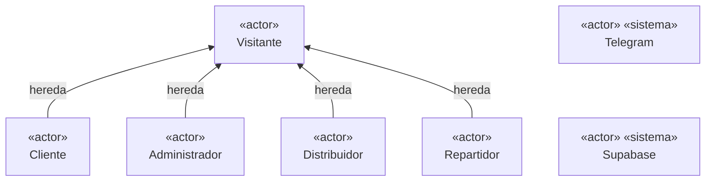
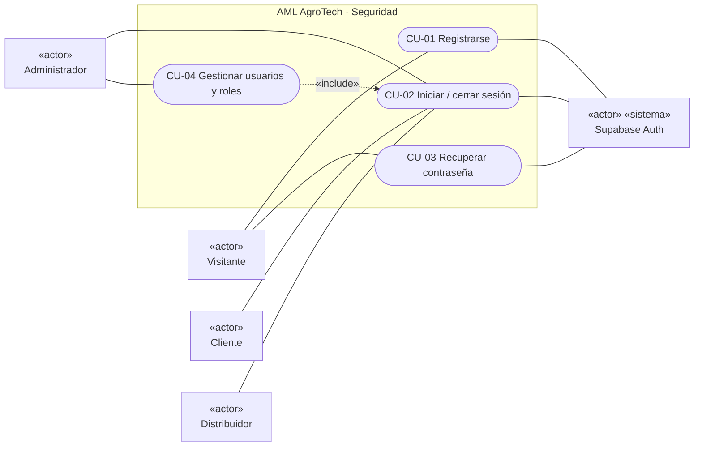
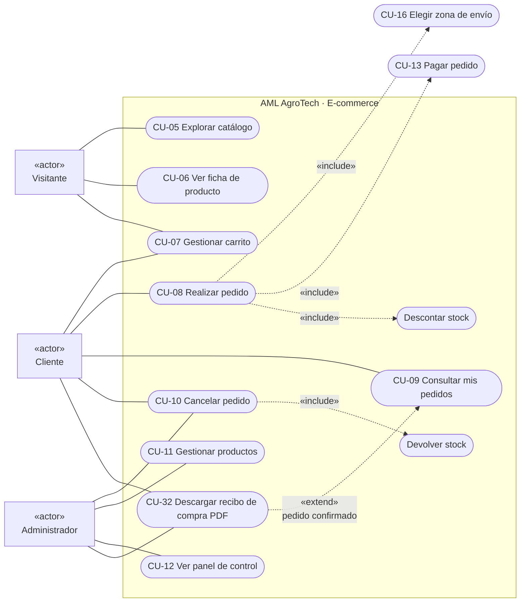
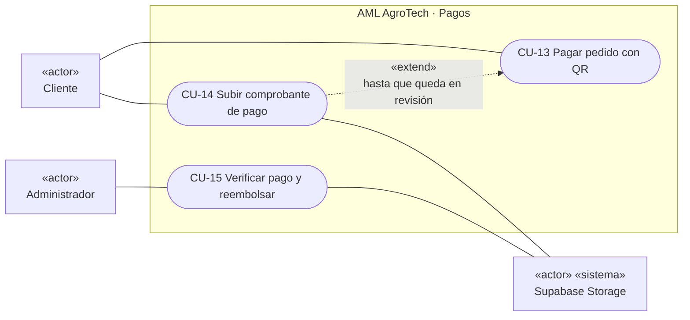
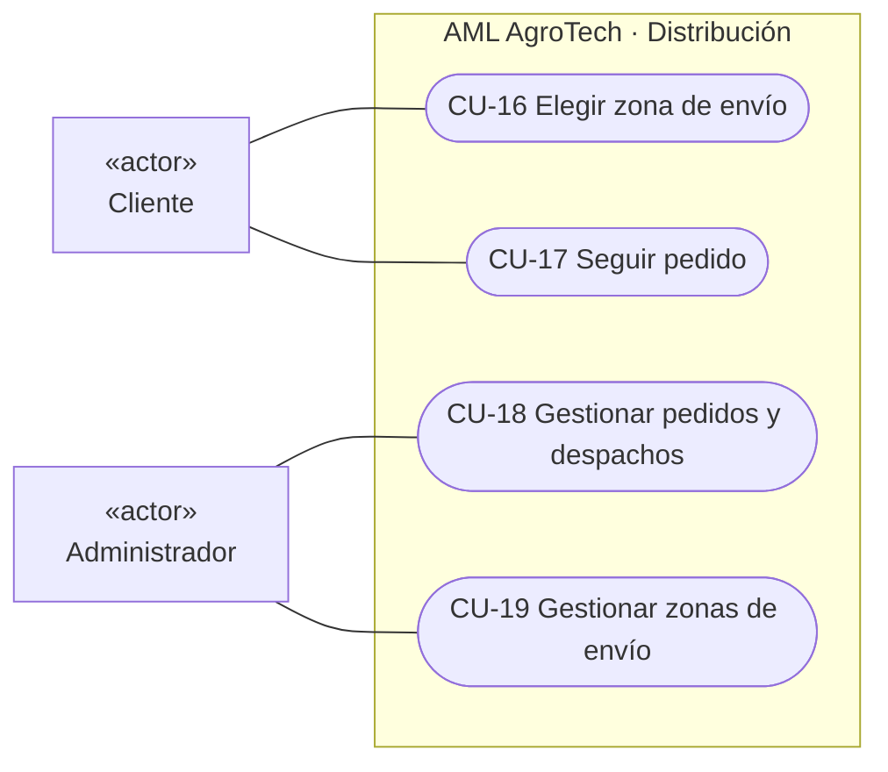
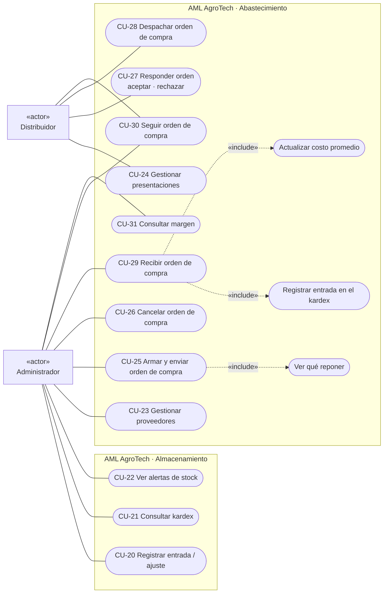
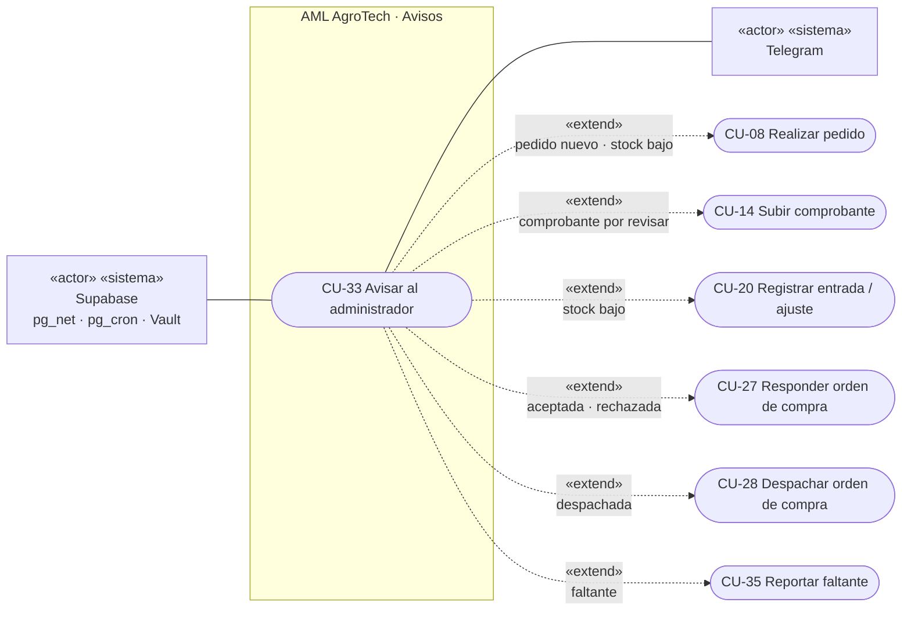
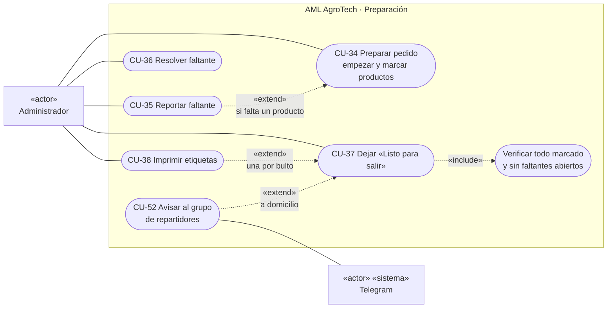
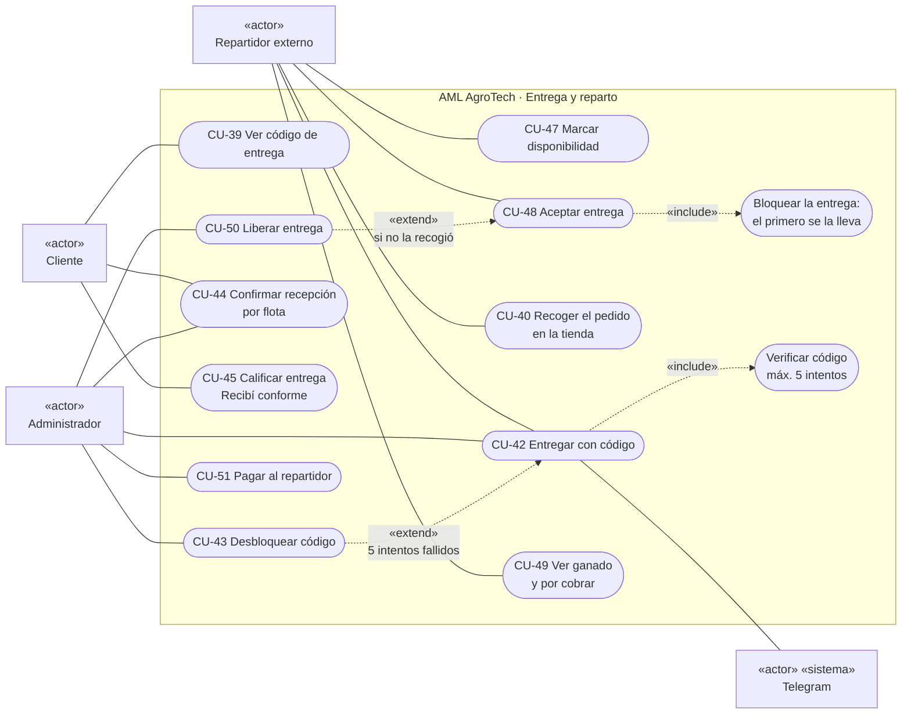

# Diagrama de casos de uso

Fuente: [`../specs/06-casos-de-uso.md`](../specs/06-casos-de-uso.md) (catálogo, HU y relaciones). Mermaid no tiene un tipo «casos de uso», así que se dibuja con `flowchart`:

| En el diagrama | Significa |
|---|---|
| Caja `«actor»` | Actor (persona o sistema externo) |
| Óvalo `CU-nn` | Caso de uso |
| Recuadro con título | Límite del sistema (un pilar de AML AgroTech) |
| Línea continua | El actor participa en el caso de uso |
| Flecha punteada `«include»` / `«extend»` | Relación entre casos de uso |
| Flecha `hereda` | Generalización entre actores |

Para que se lea, va un diagrama por pilar. En todos, los casos de uso del Administrador, del Distribuidor y del Repartidor «incluyen» CU-02 Iniciar sesión con su rol; no se dibuja esa línea en cada uno.

## 1. Actores

## 2. Seguridad

## 3. E-commerce

## 4. Pagos

## 5. Distribución

## 6. Almacenamiento y abastecimiento

## 7. Avisos por Telegram

Condición de todos los «extend» de CU-33: la cuenta no es de prueba y los secretos de Telegram están en Vault. El resumen diario de las 20:00 lo inicia `pg_cron` (actor Supabase) sin otro caso de uso.

## 8. Preparación y «Listo para salir» (fase 9C; desde la 9F, solo el admin)

- Desde la 9F no hay rol Almacén: todo lo hace el Administrador en «Por preparar».
- Mientras un faltante (CU-35) siga abierto, CU-37 no se puede completar: lo destraba CU-36.
- Cada caso deja su paso en la línea de tiempo del pedido con **quién** y **cuándo** (CU-17 Seguir pedido).

## 9. Entrega, reparto externo y cierre (fases 9D y 9F)

- El Repartidor entrega a domicilio; el Administrador entrega en tienda (recojo) y puede entregar a domicilio si lo lleva él.
- CU-48 exige que el repartidor esté disponible (CU-47). Las entregas disponibles no muestran el nombre ni el teléfono del cliente hasta que se aceptan.
- CU-39 lo ve **solo el dueño**: ni el repartidor ni el admin.
- Telegram avisa al grupo de repartidores (CU-52, sección 8) y al admin de la entrega, del código bloqueado y de una calificación de 1 o 2 estrellas (CU-33).
- CU-41 (cobro en efectivo) y CU-46 (recibir el efectivo) se retiraron en la 9F: solo se paga con QR.
