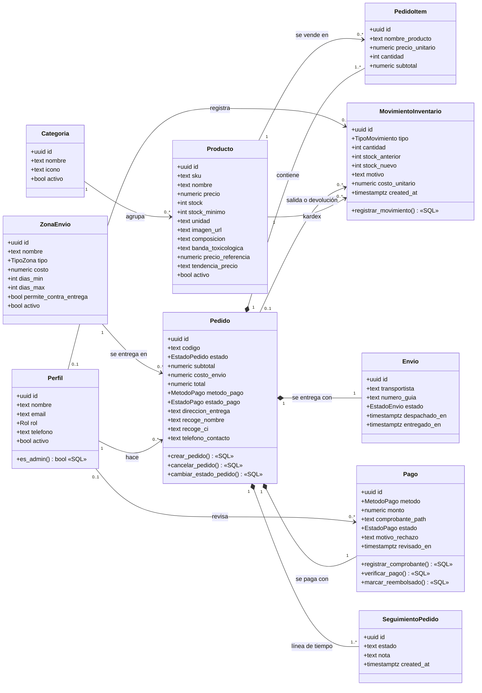
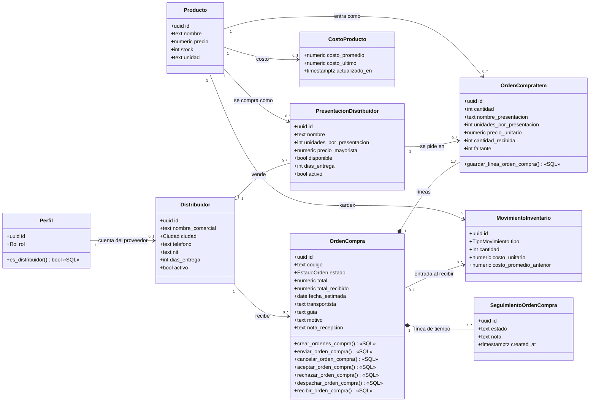
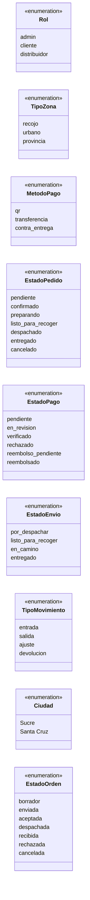

# Diagrama de clases (modelo de datos)

Cada clase es una tabla real de Postgres (esquema `public`, migraciones `0001` a `0015`). Van los atributos principales; los `created_at` / `updated_at` se omiten salvo cuando son parte del negocio. Las operaciones `«SQL»` son las funciones transaccionales que cambian esa tabla: la API no escribe directo en las tablas de pedidos, pagos, kardex ni órdenes de compra (RLS sin `insert`/`update`), todo pasa por esas funciones.

| Clase | Tabla |
|---|---|
| Perfil | `perfiles` (1 a 1 con `auth.users` de Supabase Auth) |
| Categoria | `categorias` |
| Producto | `productos` |
| ZonaEnvio | `zonas_envio` |
| Pedido | `pedidos` |
| PedidoItem | `pedido_items` |
| Pago | `pagos` |
| Envio | `envios` |
| SeguimientoPedido | `seguimiento_pedido` |
| MovimientoInventario | `movimientos_inventario` (kardex) |
| Distribuidor | `distribuidores` |
| PresentacionDistribuidor | `presentaciones_distribuidor` |
| CostoProducto | `costos_producto` |
| OrdenCompra | `ordenes_compra` |
| OrdenCompraItem | `orden_compra_items` |
| SeguimientoOrdenCompra | `seguimiento_orden_compra` |

## 1. Tienda: catálogo, pedidos, pagos, envíos e inventario

## 2. Abastecimiento: proveedores y órdenes de compra

## 3. Enumeraciones (restricciones `check` de la base)

## Notas del modelo

- **Sin borrado físico:** productos, zonas, proveedores y presentaciones se desactivan (`activo = false`); el kardex y las líneas de tiempo solo reciben `insert`. La única excepción está documentada en [`../ESTADO.md`](../ESTADO.md) (limpieza de pruebas en `costos_producto`).
- **Precios congelados:** `PedidoItem.precio_unitario` y `OrdenCompraItem.precio_unitario` guardan el precio del momento; si el producto o la presentación cambian de precio después, el pedido o la orden no cambian.
- **Stock protegido:** `Producto.stock` solo cambia dentro de las funciones que registran un `MovimientoInventario` (trigger `proteger_stock_producto`) y nunca queda negativo.
- **Costo aparte:** `CostoProducto` es solo del admin, porque `Producto` se lee sin sesión.
