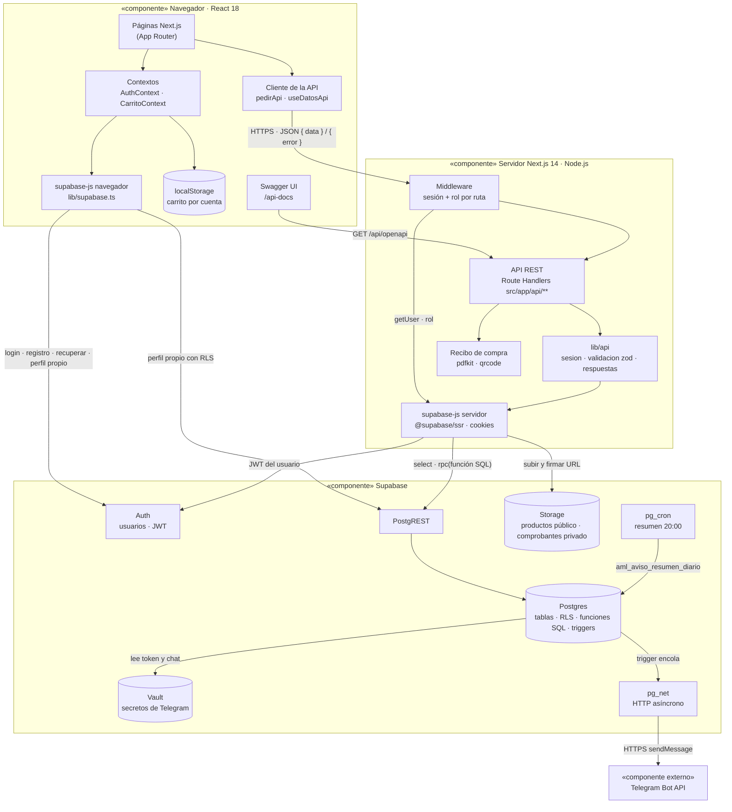
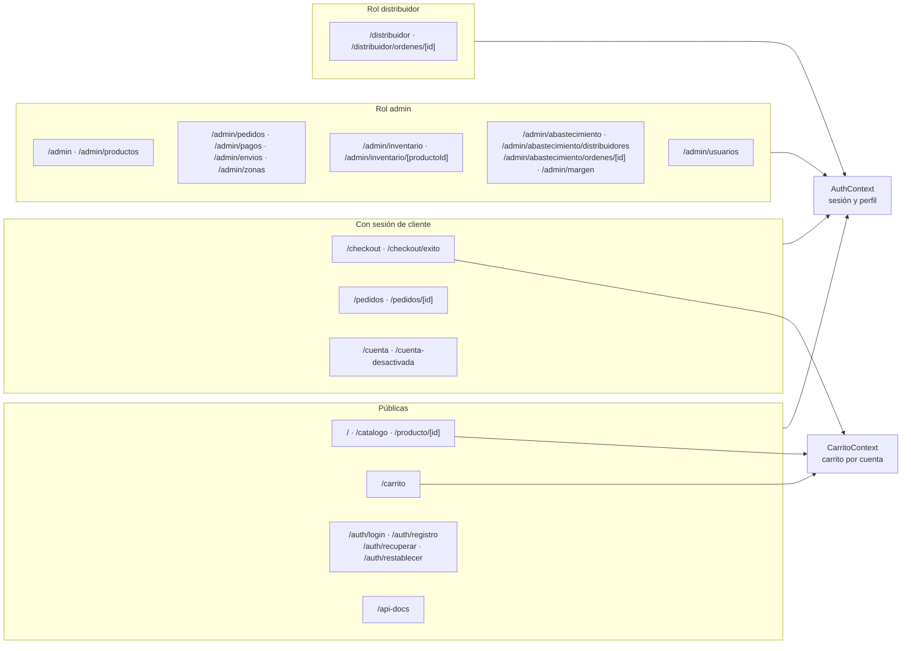
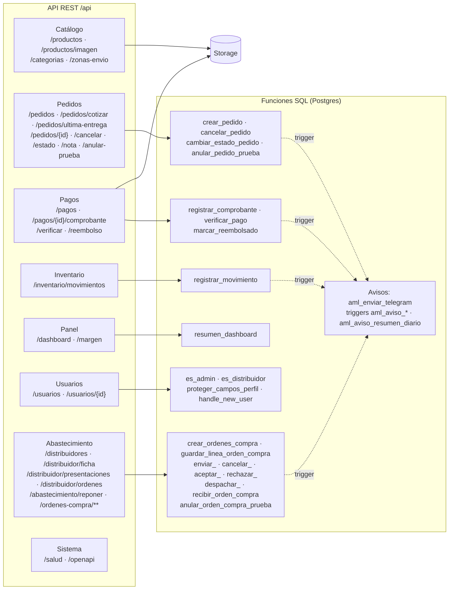

# Diagrama de componentes

Cómo se arma la aplicación por dentro y qué interfaz usa cada parte. Mermaid no tiene un tipo «componentes», así que va con `flowchart`: cada recuadro es un componente (o un grupo de componentes) y cada flecha dice qué interfaz usa.

## 1. Vista general

**Clave de seguridad:** la API usa la clave pública (`anon`) con el JWT del usuario, nunca la `service_role`. Lo que el usuario puede ver o cambiar lo decide la base con RLS y funciones `security definer`, además del middleware y de los chequeos de rol de la API (tres capas).

## 2. Páginas del navegador

El middleware pide sesión en `/checkout`, `/pedidos` y `/cuenta`, rol `admin` en `/admin/**` y rol `distribuidor` en `/distribuidor/**`, verificados en el servidor.

## 3. API REST y funciones SQL

42 rutas y 50 operaciones; contrato completo en [`../api/openapi.yaml`](../api/openapi.yaml) y en vivo en `/api-docs`.

Las lecturas simples (listas, detalle) son `select` con columnas explícitas sobre las tablas, filtradas por RLS. Toda escritura que mueve stock, dinero o estados pasa por una función SQL en una sola transacción.
