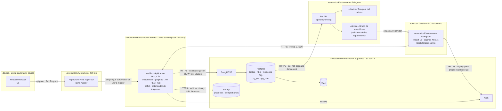

# Diagrama de despliegue

Dónde corre cada parte en producción. Mermaid no tiene un tipo «despliegue», así que va con `flowchart`: cada recuadro es un **nodo** (`«device»` o `«executionEnvironment»`) con sus artefactos adentro, y cada flecha es una conexión con su protocolo.

## Nodos

| Nodo | Qué corre ahí | Notas |
|---|---|---|
| Celular o PC del usuario | El navegador con la app (React) | El carrito vive en `localStorage`, uno por cuenta. Probado a 360 px |
| Render | La aplicación Next.js: páginas, middleware y la API REST | Plan gratis: la primera visita tras un rato sin uso tarda unos 45 s en despertar. URL: https://aml-agrotech.onrender.com |
| Supabase | Auth, Postgres, Storage y Vault | Postgres tiene `pg_net` (manda los avisos) y `pg_cron` (resumen diario a las 00:00 UTC = 20:00 de Bolivia) |
| Telegram | Bot API, el chat del admin y el grupo de repartidores | Los avisos salen de la base, no de Render: llegan aunque Render esté dormido. El grupo solo recibe «Entrega disponible» con el enlace a `/repartidor` |
| GitHub | El repositorio | Cada fase entra a `master` por Pull Request; Render publica solo al unir |

## Configuración por nodo

- **Render** (variables de entorno): `NEXT_PUBLIC_SUPABASE_URL`, `NEXT_PUBLIC_SUPABASE_ANON_KEY`, `NEXT_PUBLIC_WHATSAPP_TIENDA`, `NEXT_PUBLIC_TELEGRAM_GRUPO_REPARTIDORES` (enlace de invitación al grupo) y, opcional, `NEXT_PUBLIC_QR_TIENDA_IMAGEN`. **Ninguna clave secreta**: ni `service_role` ni el token de Telegram.
- **Supabase Vault**: `aml_telegram_token`, `aml_telegram_chat_admin` y `aml_telegram_chat_repartidores`. Sin ellos, los avisos no hacen nada.
- **Migraciones**: `supabase/migrations/0001` a `0022`, todas corridas a mano en el SQL Editor de Supabase.
