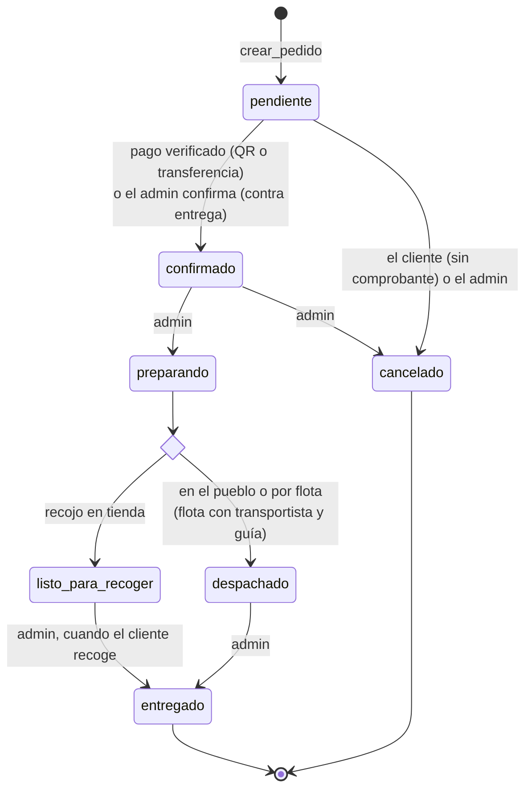
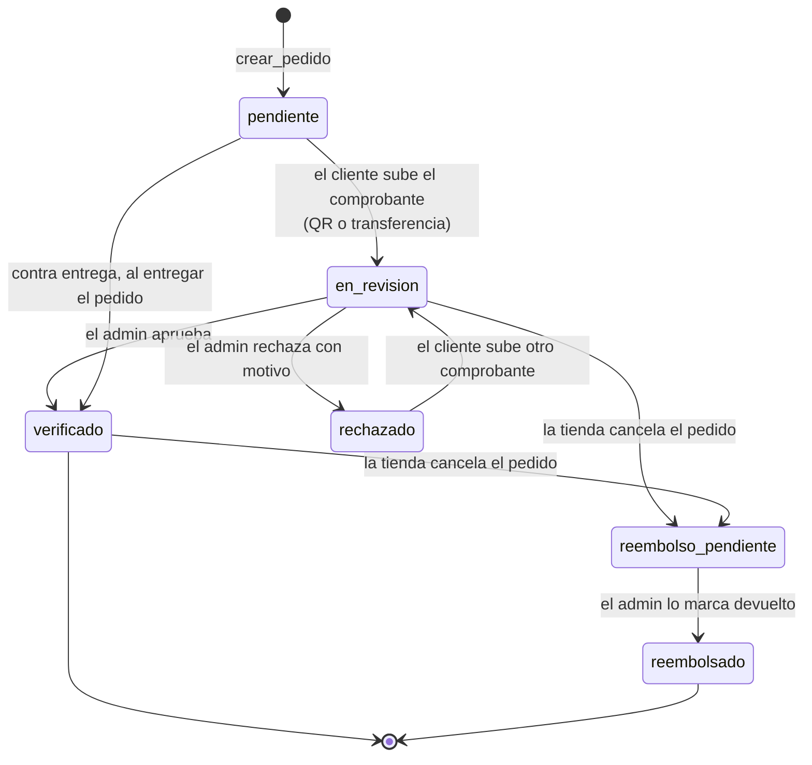
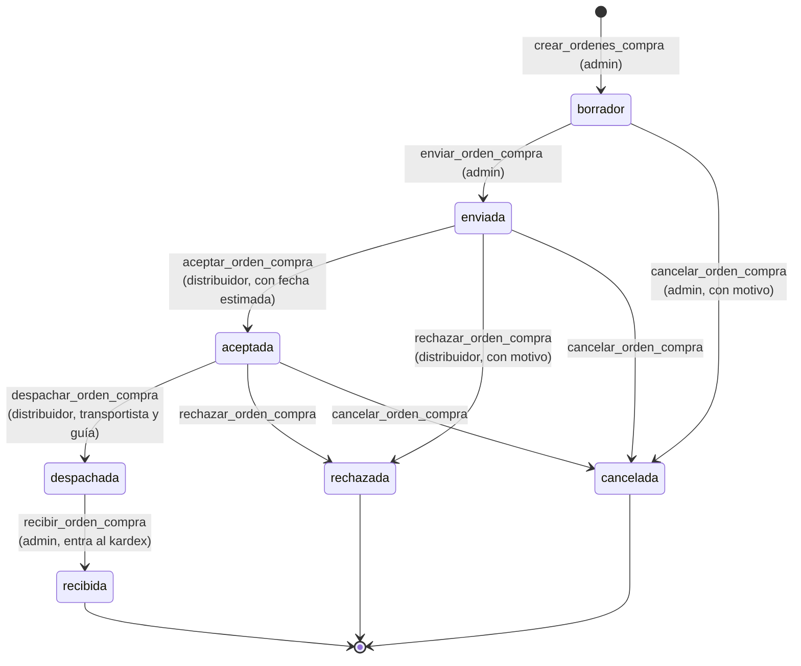

# Diagramas de estados

Los estados son restricciones `check` de la base y **solo cambian dentro de funciones SQL** que validan quién puede hacerlo y desde qué estado. Cada cambio queda en la línea de tiempo (`seguimiento_pedido` o `seguimiento_orden_compra`).

## 1. Pedido

`cambiar_estado_pedido` solo deja avanzar al siguiente estado del camino que corresponde a la zona. Un pedido con QR o transferencia no pasa de `pendiente` hasta que su pago esté verificado.

- Cancelar devuelve el stock al kardex (`devolucion`).
- El cliente solo cancela si el pedido y el pago siguen pendientes. Si ya mandó el comprobante, tiene que pedírselo a la tienda.

## 2. Pago

- Funciones: `registrar_comprobante`, `verificar_pago`, `cancelar_pedido` y `marcar_reembolsado`.
- El monto es siempre el total del pedido, lo pone la base.
- Si se cancela un pedido con el pago `pendiente` o `rechazado`, el pago queda como estaba: no hubo plata que devolver.

## 3. Orden de compra

- Una orden despachada ya no se cancela: se recibe, aunque no llegue nada (todo queda como faltante).
- El distribuidor nunca ve los borradores.
- Telegram avisa al admin al pasar a aceptada, rechazada o despachada, salvo que el proveedor sea de prueba.
