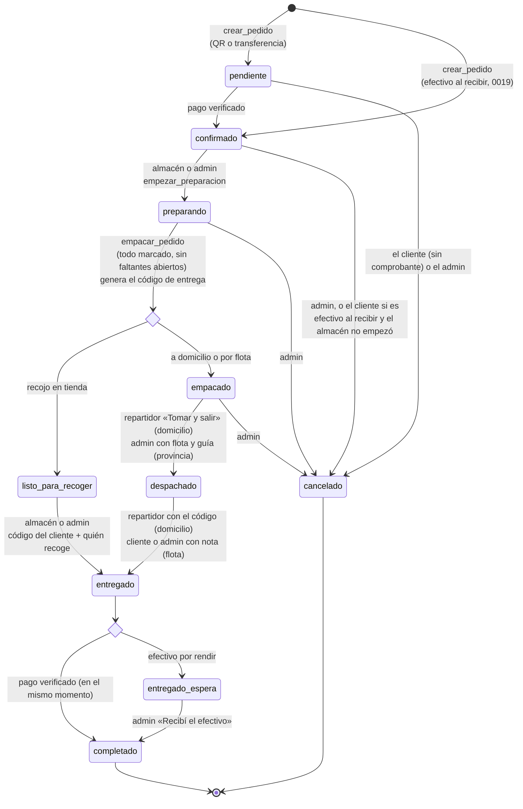
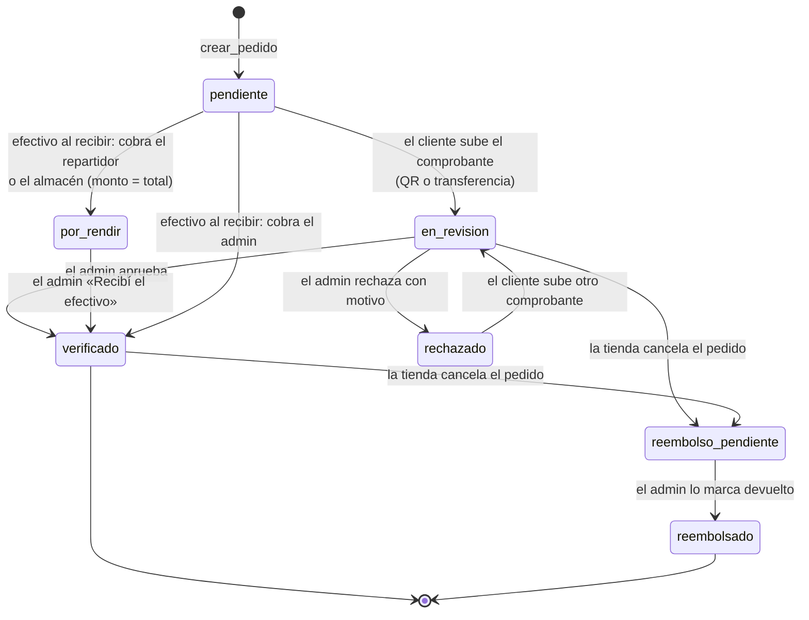
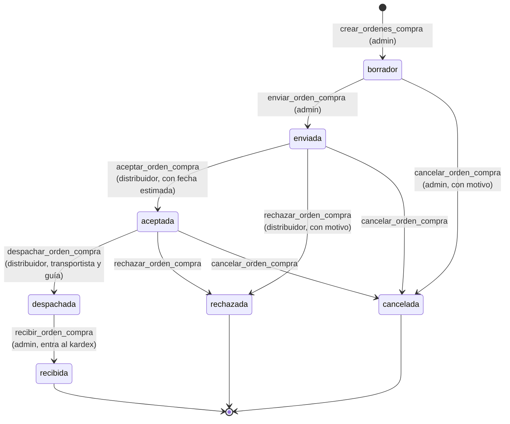

# Diagramas de estados

Los estados son restricciones `check` de la base y **solo cambian dentro de funciones SQL** que validan quién puede hacerlo y desde qué estado. Cada cambio queda en la línea de tiempo (`seguimiento_pedido` o `seguimiento_orden_compra`).

## 1. Pedido

`cambiar_estado_pedido` (admin) solo confirma y despacha por flota. Preparar y empacar se hacen **solo** con las funciones del almacén (`empezar_preparacion`, `empacar_pedido`, 0017). Desde la **0018 nadie marca «entregado» sin prueba**: a domicilio y en tienda hace falta el **código de 4 dígitos del cliente** (`entregar_pedido`); por flota lo confirma el cliente («Recibí mi pedido») o el admin con una nota (`confirmar_recepcion`). Un pedido con QR o transferencia no pasa de `pendiente` hasta que su pago esté verificado.

- `entregado_espera` no es otro estado: es `entregado` con el efectivo de efectivo al recibir todavía en manos del repartidor o del almacén. Se dibuja aparte para que se lea.
- **Código de entrega:** 5 intentos fallidos lo bloquean; el pedido no se entrega hasta que el admin lo desbloquea con una nota. El cliente lo ve en «Mis pedidos»; el repartidor, el almacén y el admin nunca.
- **Efectivo al recibir:** antes del código se registra el cobro (`registrar_cobro_entrega`, monto igual al total).
- Cancelar devuelve el stock al kardex (`devolucion`) y cierra los faltantes abiertos. Un pedido despachado ya no se cancela.
- En `preparando`, un faltante reportado frena el empaque hasta que el admin lo resuelve («Repuesto, continuar»). El cliente ve solo «Revisando un producto de tu pedido».

## 2. Pago

- `por_rendir` es `pendiente` con `cobrado_en` lleno (0018): se ve como «Efectivo por rendir» en `/admin/pagos`.
- Funciones: `registrar_comprobante`, `verificar_pago`, `registrar_cobro_entrega`, `confirmar_efectivo`, `cancelar_pedido` y `marcar_reembolsado`.
- Al verificar, la línea de tiempo y la recibo de compra dicen «Pago verificado por <nombre> · <fecha y hora>».
- El monto es siempre el total del pedido, lo pone la base.
- Si se cancela un pedido con el pago `pendiente` o `rechazado`, el pago queda como estaba: no hubo plata que devolver.

## 3. Orden de compra

- Una orden despachada ya no se cancela: se recibe, aunque no llegue nada (todo queda como faltante).
- El distribuidor nunca ve los borradores.
- Telegram avisa al admin al pasar a aceptada, rechazada o despachada, salvo que el proveedor sea de prueba.
