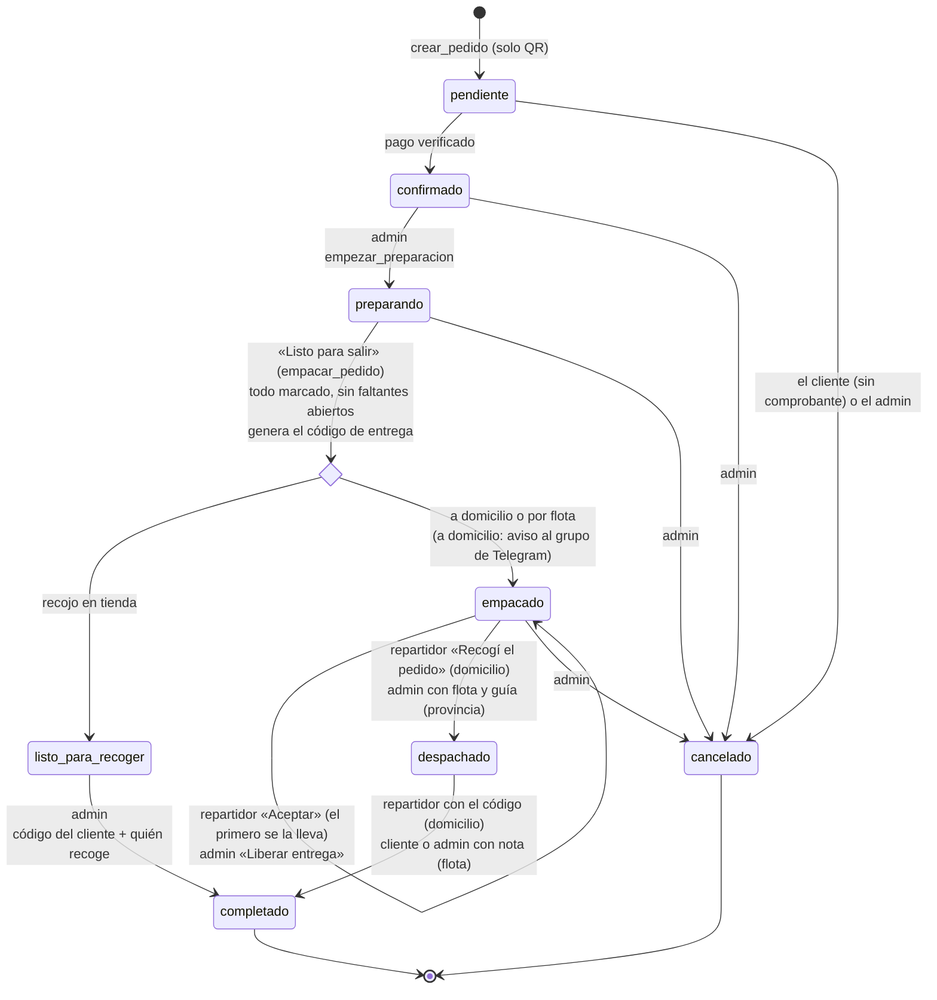
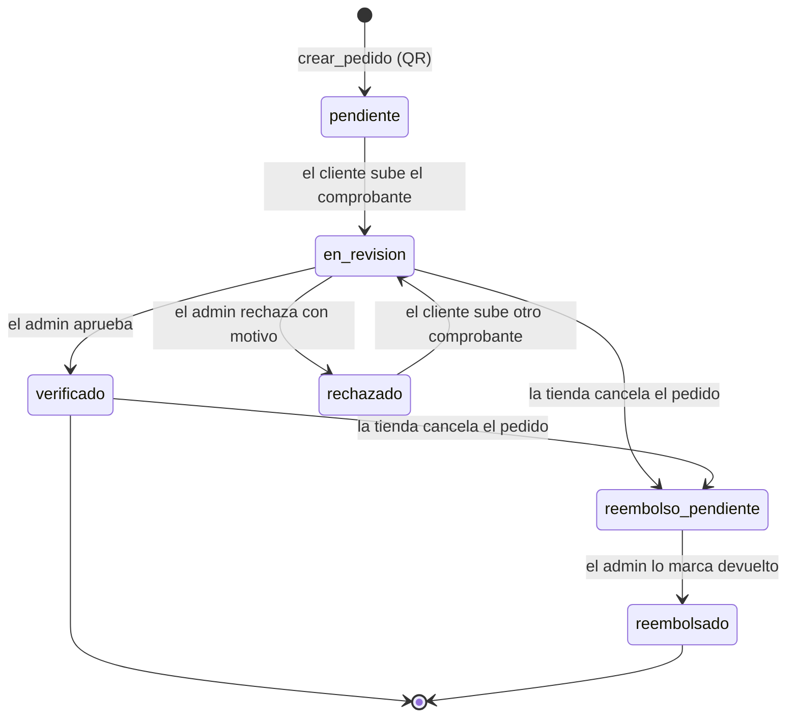
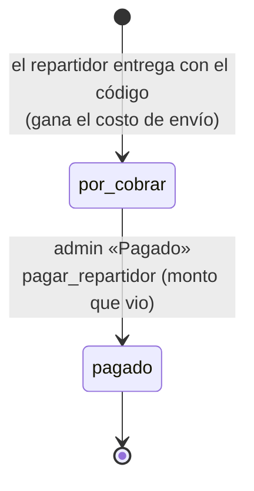
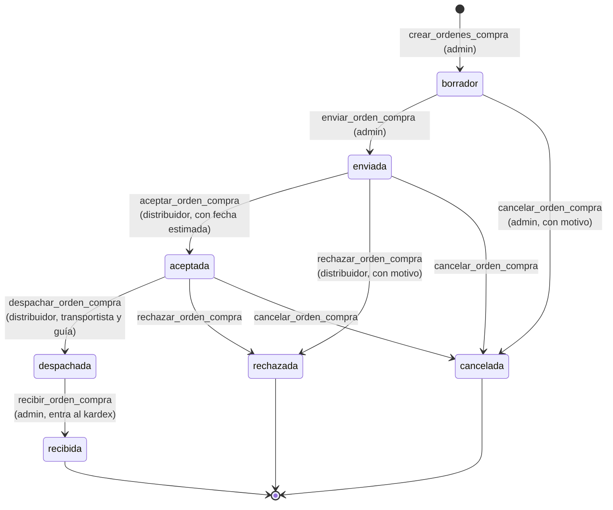

# Diagramas de estados

Los estados son restricciones `check` de la base y **solo cambian dentro de funciones SQL** que validan quién puede hacerlo y desde qué estado. Cada cambio queda en la línea de tiempo (`seguimiento_pedido` o `seguimiento_orden_compra`).

## 1. Pedido

Flujo final (fase 9F, migración 0020): **solo QR**, el admin prepara y deja «Listo para salir», y a domicilio lo lleva un **repartidor externo** que acepta la entrega. `cambiar_estado_pedido` (admin) solo confirma y despacha por flota. Preparar y dejar listo se hacen **solo** con `empezar_preparacion` y `empacar_pedido`. **Nadie marca «entregado» sin prueba**: a domicilio y en tienda hace falta el **código de 4 dígitos del cliente** (`entregar_pedido`); por flota lo confirma el cliente («Recibí mi pedido») o el admin con una nota (`confirmar_recepcion`).

- En pantalla `empacado` se llama **«Listo para salir»**. Mientras está así, a domicilio puede estar **sin repartidor** (disponible para aceptar) o **aceptada** (`repartidor_id` lleno, esperando que la recojan). No son estados distintos: es la misma fila con o sin repartidor.
- Como el QR ya está verificado al preparar, la entrega pasa por `entregado` y queda `completado` en el mismo momento (se dibuja directo para que se lea).
- **Código de entrega:** 5 intentos fallidos lo bloquean; el pedido no se entrega hasta que el admin lo desbloquea con una nota. Solo el cliente lo ve en «Mis pedidos».
- Cancelar devuelve el stock al kardex (`devolucion`) y cierra los faltantes abiertos. Un pedido que ya salió de la tienda no se cancela.
- En `preparando`, un faltante reportado frena «Listo para salir» hasta que el admin lo resuelve. El cliente ve solo «Revisando un producto de tu pedido».
- Pedidos viejos con efectivo o transferencia: quedaron en su estado final (cancelados o completados); la 0020 frena si encuentra alguno abierto.

## 2. Pago

- Funciones: `registrar_comprobante`, `verificar_pago`, `cancelar_pedido` y `marcar_reembolsado`. `registrar_cobro_entrega` y `confirmar_efectivo` (efectivo, 0018) siguen en la base pero nadie puede llamarlas desde la 0020.
- Al verificar, la línea de tiempo y el recibo de compra dicen «Pago verificado por <nombre> · <fecha y hora>».
- El monto es siempre el total del pedido, lo pone la base.

## 3. Pago al repartidor

- `por_cobrar` es un pedido `completado` con `repartidor_id` y sin `pago_repartidor_id`. «Pagado» marca **todas** las entregas sin pagar de ese repartidor en una sola fila de `pagos_repartidor` (monto, entregas, quién y cuándo). Si el monto cambió mientras el admin miraba, frena.

## 4. Orden de compra

- Una orden despachada ya no se cancela: se recibe, aunque no llegue nada (todo queda como faltante).
- El distribuidor nunca ve los borradores.
- Telegram avisa al admin al pasar a aceptada, rechazada o despachada, salvo que el proveedor sea de prueba.
