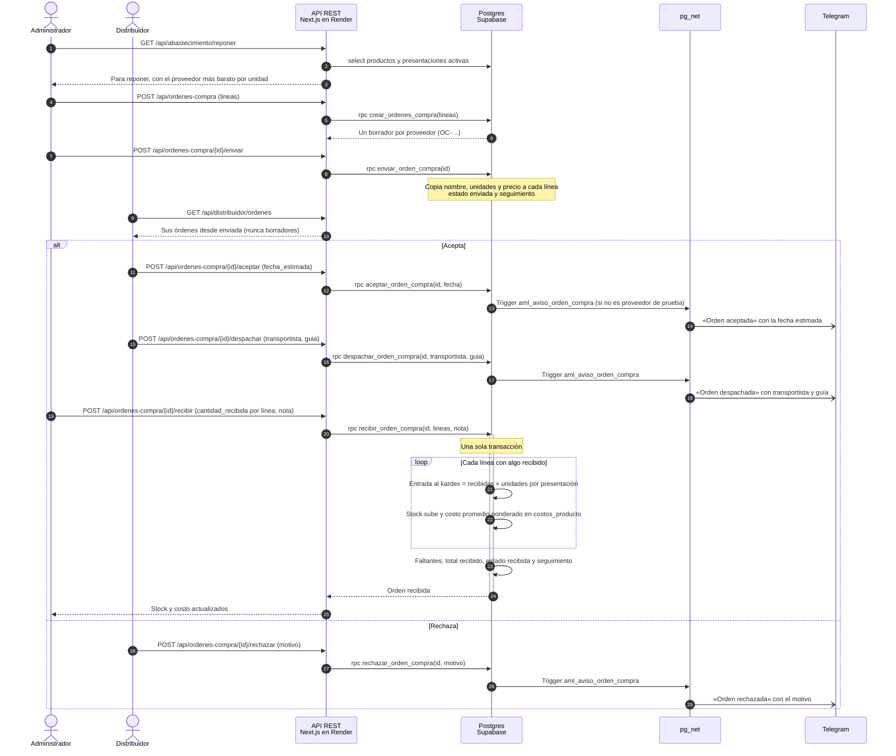
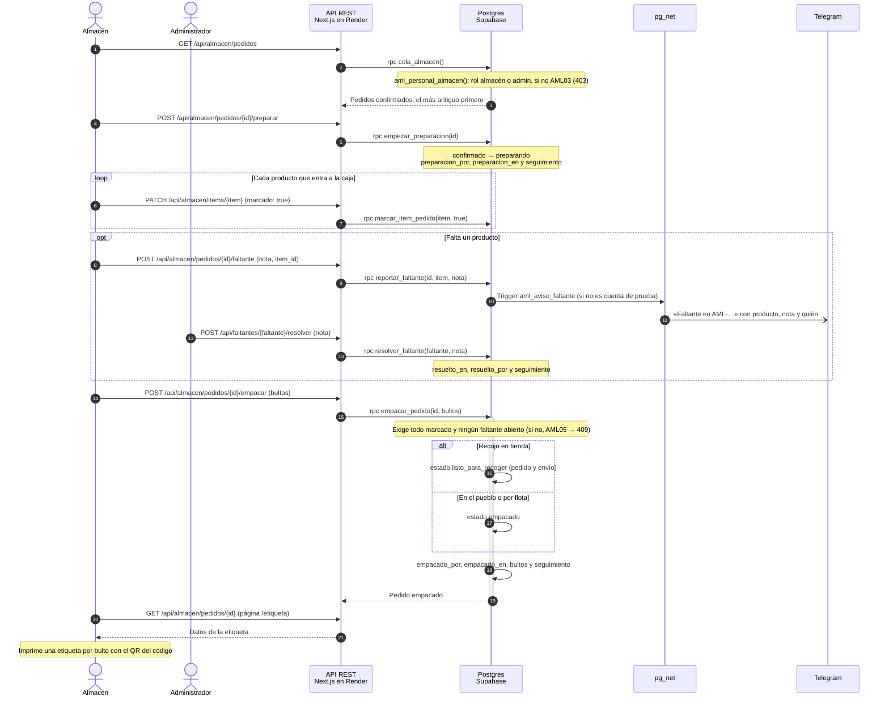
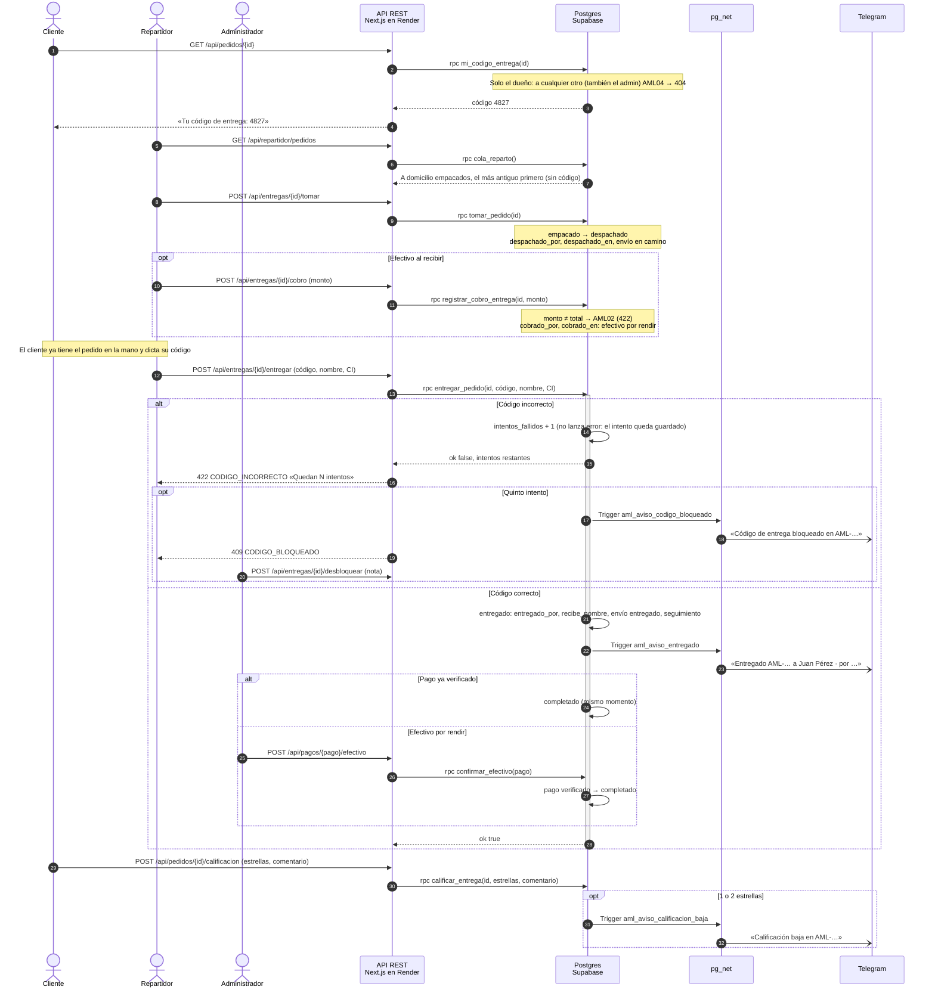

# Diagramas de secuencia

Dos recorridos de punta a punta, con las rutas y funciones reales.

## 1. Realizar pedido (CU-08)

Compra en 3 clics (fase 9E): «Ir a pagar» en el carrito, «Confirmar pedido» en una sola pantalla y la foto del pago debajo del QR. El total lo calcula siempre la base; el navegador solo manda productos y cantidades.

```mermaid
sequenceDiagram
  autonumber
  actor C as Cliente
  participant N as Navegador<br/>/checkout
  participant K as CarritoContext<br/>localStorage
  participant A as API REST<br/>Next.js en Render
  participant DB as Postgres<br/>Supabase
  participant Q as pg_net
  participant T as Telegram

  C->>N: «Ir a pagar»: datos recordados y QR ya marcados; elige o cambia la zona
  N->>A: POST /api/pedidos/cotizar (items, zona_id)
  A->>A: requerirSesion() y validación zod
  A->>DB: select zona activa y productos (precio, stock)
  DB-->>A: filas con RLS
  A-->>N: 200 subtotal, costo_envio, total
  N-->>C: «Tu compra» con el total del servidor

  C->>N: «Confirmar pedido» (dentro de «Tu compra»; en celular, barra fija abajo)
  Note over N: Si falta un dato: borde rojo y mensaje debajo del campo,<br/>la vista va al primero y no se llama a la API
  N->>A: POST /api/pedidos (items, zona, entrega, metodo_pago)
  A->>A: requerirSesion() y validación zod
  A->>DB: rpc crear_pedido(...)
  activate DB
  Note over DB: Una sola transacción
  DB->>DB: Bloquea los productos y lee precios reales
  alt Falta stock de algún producto
    DB-->>A: error STOCK_INSUFICIENTE (producto, disponible)
    A-->>N: 409 con el producto y lo disponible
    N->>K: ajustarStock() (el carrito sigue)
    N-->>C: Aviso junto al botón; el carrito y el total se ajustan
  else Hay stock
    DB->>DB: Inserta pedido AML-…, items, pago, envío y seguimiento<br/>(efectivo al recibir: nace confirmado y va al almacén)
    DB->>DB: Descuenta stock y anota la salida en el kardex
    DB->>DB: COMMIT
    DB->>Q: Trigger aml_aviso_pedido_nuevo encola el mensaje (si la cuenta no es de prueba)
    DB-->>A: id, codigo, total
    deactivate DB
    A-->>N: 201 id, codigo, total
    N->>K: limpiarCarrito() guarda el carrito vacío en el momento
    N->>A: GET /api/pedidos/{id} (pantalla de éxito)
    A-->>N: Pedido con el siguiente paso
    N-->>C: QR con el monto y, debajo, «Sube la foto del pago» con «Enviar»
    Q-)T: sendMessage «Pedido nuevo» al chat del admin
  end
```

En la misma pantalla del QR el cliente sube la foto del pago (`POST /api/pagos/{id}/comprobante` → `registrar_comprobante`, pago `en_revision`, aviso «Comprobante por revisar») y el admin lo aprueba o rechaza (`PATCH /api/pagos/{id}/verificar` → `verificar_pago`).

## 2. Orden de compra (CU-25 a CU-29)

Del producto por reponer a la mercadería en el kardex con su costo.



El admin también puede cancelar la orden con motivo mientras esté en borrador, enviada o aceptada (`POST /api/ordenes-compra/{id}/cancelar`).

## 3. Preparar y empacar un pedido (CU-34 a CU-38, fase 9C)

Del pedido pagado a la caja cerrada con su etiqueta. Cada paso guarda quién y cuándo.



El cliente ve cada paso en su pedido con el nombre de quién lo hizo (`GET /api/pedidos/{id}` → `linea_tiempo_pedido`).

## 4. Entregar un pedido con código y cerrarlo (CU-39 a CU-46, fase 9D)

Del pedido empacado a la entrega con prueba y al cierre. Nadie marca «entregado» sin el código que solo tiene el cliente.



- **Recojo en tienda:** igual, pero entrega el almacén o el admin desde el pedido («Entregar en tienda»), con nombre y CI de quien recoge.
- **Por flota:** no hay código. El cliente toca «Recibí mi pedido» (`POST /api/pedidos/{id}/recibido`) o el admin lo confirma con una nota.
- Las cuentas de prueba (`@amlagrotech.test`) no avisan por Telegram.
