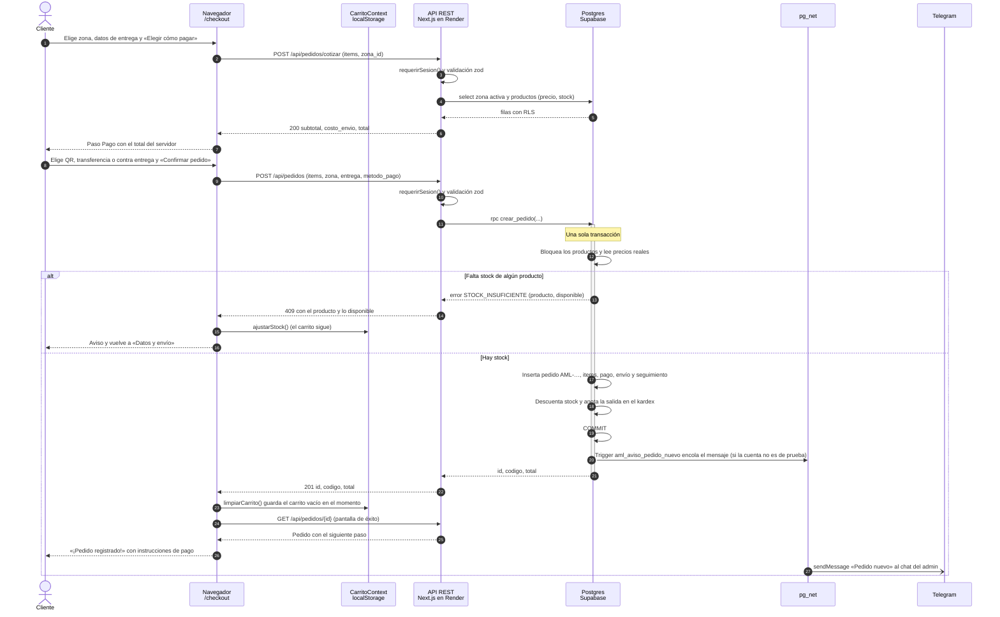
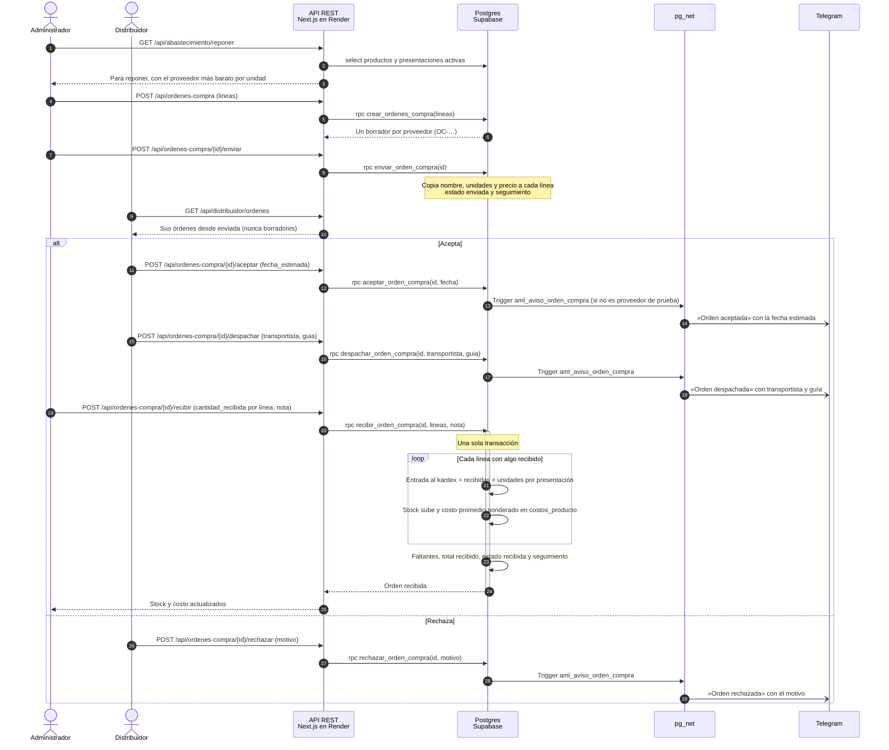

# Diagramas de secuencia

Dos recorridos de punta a punta, con las rutas y funciones reales.

## 1. Realizar pedido (CU-08)

Desde «Elegir cómo pagar» en `/checkout` hasta la pantalla de éxito. El total lo calcula siempre la base; el navegador solo manda productos y cantidades.

Después, si eligió QR o transferencia, el cliente sube el comprobante (`POST /api/pagos/{id}/comprobante` → `registrar_comprobante`, pago `en_revision`, aviso «Comprobante por revisar») y el admin lo aprueba o rechaza (`PATCH /api/pagos/{id}/verificar` → `verificar_pago`).

## 2. Orden de compra (CU-25 a CU-29)

Del producto por reponer a la mercadería en el kardex con su costo.

El admin también puede cancelar la orden con motivo mientras esté en borrador, enviada o aceptada (`POST /api/ordenes-compra/{id}/cancelar`).
